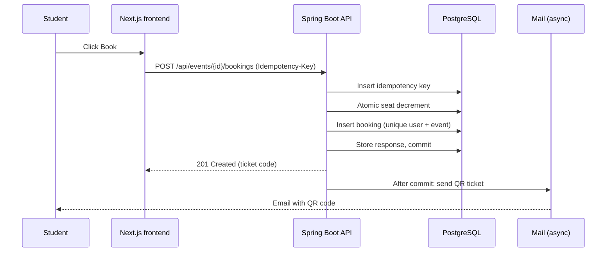
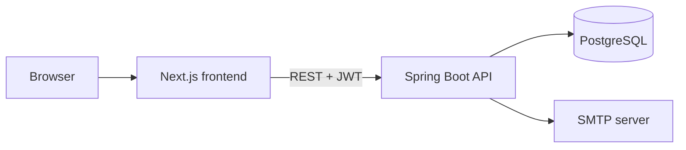

# 🎟️ SeatDibs

**Find it. Book it. Be there.**

SeatDibs is a full-stack event ticket booking platform for universities. Students browse events, book a ticket, and receive a QR code by email. Admins create events, see who is coming, and check tickets in at the door.

The interesting part is the backend: every seat is sold exactly once, even when hundreds of people book the last seats at the same moment. Bookings are safe to retry, emails never slow a booking down, and every ticket works exactly once at check-in.

**Live demo:** _TODO: add link_  ·  **API docs:** _TODO: add Swagger link_

_TODO: add 2 or 3 screenshots (event list, ticket with QR code, admin check-in)._

## Contents

- [Features](#features)
- [How it works](#how-it-works)
- [Architecture](#architecture)
- [Tech stack](#tech-stack)
- [Data model](#data-model)
- [API overview](#api-overview)
- [Getting started](#getting-started)
- [Testing](#testing)
- [Load test results](#load-test-results)
- [Deployment](#deployment)
- [Project structure](#project-structure)
- [Limitations and roadmap](#limitations-and-roadmap)

## Features

**Students**
- Browse upcoming events with search and pagination
- See live seat availability
- Book one ticket per event
- Receive a QR-code ticket by email, and view it again any time in the app
- View all own bookings and ticket status

**Admins**
- Create, edit, and cancel events
- View the attendee list for each event
- Check in tickets at the venue; a ticket can only be used once
- Manage users and roles

**Engineering**
- Concurrency-safe seat booking with no overselling
- Idempotent booking endpoint, safe to retry
- Asynchronous QR-ticket emails with retries
- JWT authentication with role-based access (USER, ADMIN)
- Consistent RFC 7807 error responses
- Dockerized setup, OpenAPI docs, and integration tests against a real PostgreSQL

## How it works

### The overselling problem

If two people book the last seat at the same time, a naive "read the seat count, check it, then write it back" lets both succeed. SeatDibs avoids this by doing the check and the update in one atomic SQL statement:

```sql
UPDATE events
SET available_seats = available_seats - 1
WHERE id = :id AND status = 'PUBLISHED'
  AND starts_at > now() AND available_seats > 0
```

If no row is updated, the booking is rejected. Database constraints back this up (`available_seats` can never be negative or exceed `total_seats`), and a unique constraint on `(user_id, event_id)` guarantees one ticket per user per event. Everything happens in a single transaction, so a failed booking restores the seat automatically.

### Idempotent bookings

Every booking request carries an `Idempotency-Key` header. The key is stored with the response, so repeating the same request (a double click, a network retry) returns the original result and never creates a second ticket or uses a second seat. Reusing a key for a different event returns `422`.

### Asynchronous tickets

After a booking commits, the QR code is generated and emailed in the background. A rolled-back booking never sends an email, a mail failure never fails a booking, and failed emails are retried before being marked as failed.

### One-time check-in

Check-in uses a conditional update, so if the same ticket is scanned twice at once, exactly one scan succeeds and the other is rejected as already used.

### Booking flow



## Architecture



The backend follows MVC with a layered structure: controllers handle HTTP and DTOs, services hold business rules and transactions, repositories use Spring Data JPA, and the Next.js app is the view.

## Tech stack

| Area | Technology |
|---|---|
| Frontend | Next.js (App Router), React, TypeScript, Tailwind CSS |
| Backend | Java, Spring Boot, Spring Web, Spring Security |
| Data | Spring Data JPA (Hibernate), PostgreSQL, Flyway migrations |
| Auth | JWT (jjwt), BCrypt |
| Tickets | ZXing (QR codes), Spring Mail |
| API docs | springdoc-openapi (Swagger UI) |
| Testing | JUnit 5, Mockito, Testcontainers |
| Load testing | k6 |
| Infrastructure | Docker, Docker Compose, MailHog (local email) |

## Data model

- **users**: id, name, email (unique), password hash, role, created at
- **events**: id, title, description, venue, start and end time, total seats, available seats, status
- **bookings**: id, user, event, ticket code (unique), email status, checked-in time. Unique on (user, event)
- **idempotency_keys**: id, user, key, response status and body. Unique on (user, key)

Schema changes are managed with Flyway migrations.

## API overview

Base path `/api`. Full interactive documentation is available in Swagger UI at `/swagger-ui.html`.

| Method | Path | Access | Purpose |
|---|---|---|---|
| POST | `/auth/register` | public | Create an account |
| POST | `/auth/login` | public | Get a JWT |
| GET | `/events` | public | List upcoming events |
| GET | `/events/{id}` | public | Event details and seats left |
| POST | `/events/{id}/bookings` | user | Book a ticket (needs `Idempotency-Key`) |
| GET | `/bookings/me` | user | Own bookings |
| GET | `/bookings/{id}/qr` | owner | QR code image |
| POST | `/admin/events` | admin | Create an event |
| PUT | `/admin/events/{id}` | admin | Edit an event |
| POST | `/admin/events/{id}/cancel` | admin | Cancel an event |
| GET | `/admin/events/{id}/attendees` | admin | Attendee list |
| POST | `/admin/tickets/check-in` | admin | Check in a ticket |
| GET | `/admin/users` | admin | List users |

## Getting started

### Prerequisites

- Docker and Docker Compose
- (For running without Docker) Java 21, Maven, Node.js, and a PostgreSQL instance

### Run everything with Docker

```bash
git clone https://github.com/Aman-Yati/SeatDibs.git
cd SeatDibs
cp .env.example .env
docker compose up --build
```

| Service | URL |
|---|---|
| Frontend | http://localhost:3000 |
| Backend API | http://localhost:8080 |
| Swagger UI | http://localhost:8080/swagger-ui.html |
| MailHog (see sent emails) | http://localhost:8025 |

In development, emails are caught by MailHog instead of being delivered.

### Configuration

Copy `.env.example` to `.env` and set the values.

| Variable | Purpose |
|---|---|
| `DB_URL`, `DB_USER`, `DB_PASSWORD` | PostgreSQL connection |
| `JWT_SECRET` | Signing key (at least 32 bytes) |
| `JWT_EXPIRY_MINUTES` | Token lifetime |
| `ADMIN_EMAIL`, `ADMIN_PASSWORD` | First admin account, created on startup |
| `FRONTEND_URL` | Allowed CORS origin |
| `SMTP_HOST`, `SMTP_PORT`, `SMTP_USER`, `SMTP_PASSWORD`, `MAIL_FROM` | Email settings |
| `NEXT_PUBLIC_API_URL` | Backend URL used by the frontend |

### Demo accounts

_TODO: add the demo admin and demo user credentials for the seeded dev data._

## Testing

```bash
cd backend
mvn test
```

Integration tests use Testcontainers with a real PostgreSQL database. They cover:

- 200 users booking the last 50 seats at the same time: exactly 50 succeed
- One user sending many parallel booking requests: exactly one succeeds
- Repeated requests with the same idempotency key: one booking, identical responses
- The same ticket checked in many times at once: exactly one succeeds
- Failed bookings leave the seat count unchanged
- Role-based access rules on every protected endpoint
- Bookings succeeding even when the mail server is down

## Load test results

A k6 script in `k6/` ramps up concurrent users booking the same event.

| Metric | Result |
|---|---|
| Seats available | _TODO_ |
| Concurrent users | _TODO_ |
| Confirmed bookings | _TODO_ |
| Oversold seats | _TODO_ |
| Requests per second | _TODO_ |
| p95 latency | _TODO_ |

_TODO: add the before-and-after story from a deliberately naive version of the booking logic: the failing test output, the fix, and the passing result._

## Deployment

- **Backend:** Docker container on Render with a managed PostgreSQL database
- **Frontend:** Vercel
- **Email:** an SMTP provider configured through environment variables

The health endpoint `/actuator/health` is used for the platform's health check.

## Project structure

```
SeatDibs/
├── backend/
│   └── src/main/java/com/seatdibs/
│       ├── controller/   REST controllers
│       ├── service/      Business logic and transactions
│       ├── repository/   Spring Data JPA repositories
│       ├── model/        JPA entities and enums
│       ├── dto/          Request and response records
│       ├── security/     JWT filter and security config
│       ├── config/       CORS, async executor, OpenAPI
│       ├── exception/    Custom exceptions and global handler
│       └── util/         Ticket code and QR code generation
├── frontend/             Next.js app
├── k6/                   Load test script
├── docker-compose.yml
└── .env.example
```

## Limitations and roadmap

**Current limitations**
- No payments; tickets are free
- No seat maps, only a seat count per event
- One ticket per user per event
- Runs as a single backend instance

**Possible next steps**
- Cancel a booking and free the seat
- Notify booked users when an event is cancelled
- CSV export of attendees
- Rate limiting on login and booking
- Camera-based QR scanning on the check-in page
- Redis caching for hot event reads

## Author

Built by [Aman Yati](https://github.com/Aman-Yati).
